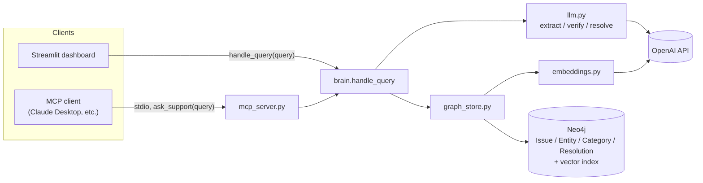
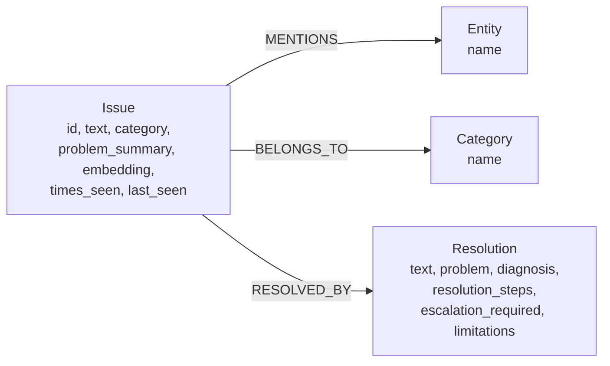
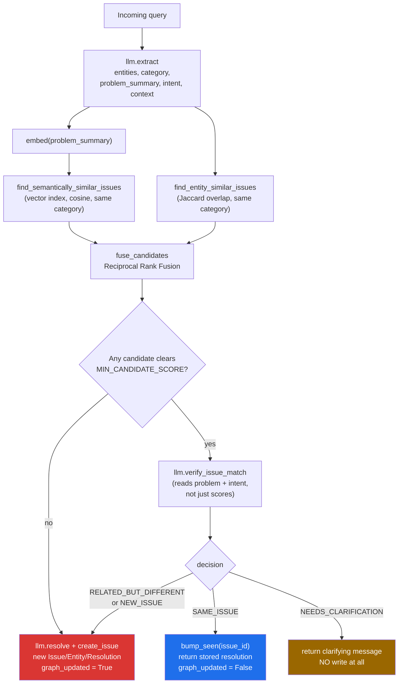
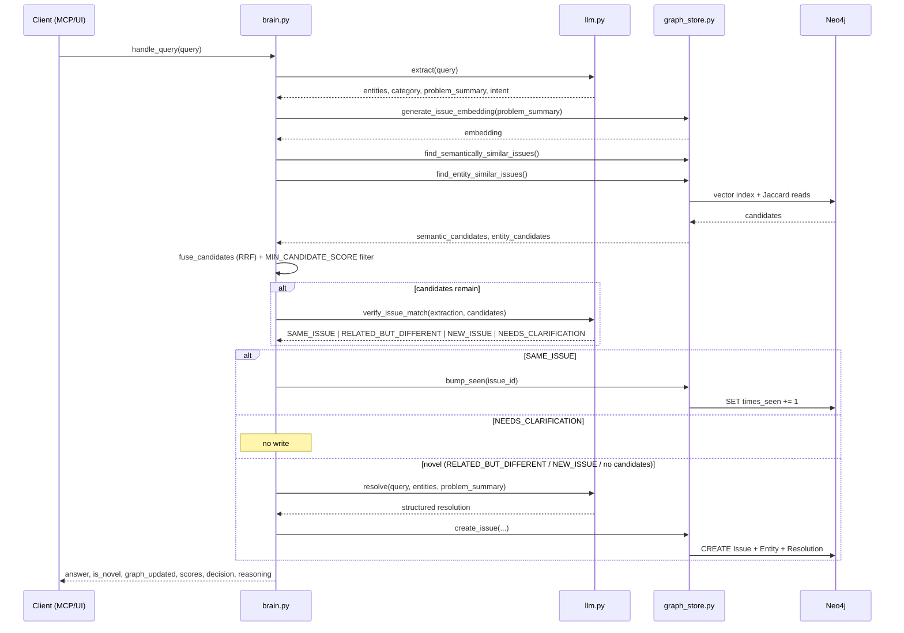

# OntoDesk — Architecture

One-page reference. For the full narrative see [`GUIDE.md`](GUIDE.md); for
operational commands see [`README.md`](README.md).

## System overview

Everything funnels through **one function**, `brain.handle_query`, so the
MCP server and the dashboard can never disagree on behavior.

## Graph schema (the ontology)

`Entity` and `Category` are `MERGE`d, so they're shared across every
`Issue` that involves them — the graph grows denser, not just bigger.

## Decision logic — the only thing that gates a write

**The rule that matters:** the LLM never writes to Neo4j directly. It only
returns a decision enum; `graph_store.bump_seen` and
`graph_store.create_issue` are the only two write paths, called explicitly
from `brain.py`'s branching. A verification result that names a candidate
id outside the ones it was shown is rejected and forced to
`NEEDS_CLARIFICATION` before it can reach that branching at all.

## One query, sequenced

## Why hybrid retrieval, in one sentence

Semantic similarity catches paraphrases that share no keywords; entity
(Jaccard) overlap catches exact-vocabulary repeats that phrase themselves
oddly enough to embed differently. **Reciprocal Rank Fusion** rewards a
candidate both signals agree on; **LLM verification** — not either score —
makes the final same/different/unsure call, because only it can read
*intent*, not just measure word or vector overlap.

## Module map

| File | Responsibility |
|---|---|
| `brain.py` | Orchestrates the flowchart above. The only thing that decides which branch runs. |
| `llm.py` | `extract`, `verify_issue_match`, `resolve` — three structured-output calls. Never writes to Neo4j. |
| `embeddings.py` | The one place that calls an embedding provider. |
| `graph_store.py` | All Cypher. Retrieval functions only read; `bump_seen`/`create_issue` are the only writes. |
| `ranking.py` | Pure Reciprocal Rank Fusion — no external calls, fully unit-testable. |
| `mcp_server.py` / `dashboard.py` | Thin callers of `brain.handle_query`. |
| `seed.py` / `backfill_embeddings.py` | Populate / migrate the graph. |
| `eval/` | Labeled dataset + precision/recall/F1 harness for calibrating thresholds. |
